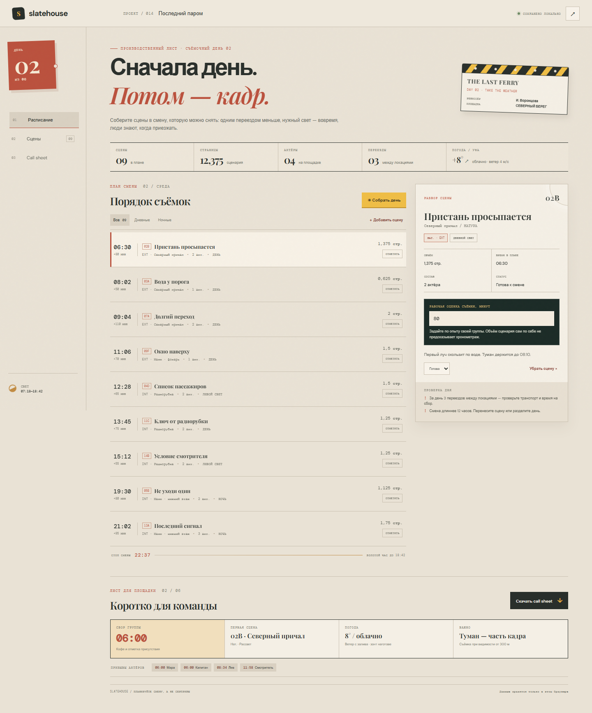
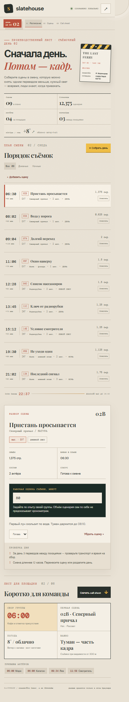

# Slatehouse

The day builder now treats moves between locations as configurable travel time; the allowance appears in the schedule and exported call sheet.

Планировщик учитывает настраиваемое время переезда между площадками и показывает его в расписании и выгруженном call sheet.

## English

**Turn a script breakdown into a shootable day.** Slatehouse is a production desk for small film crews. It groups scenes by location, protects daylight windows, estimates company moves, collects actor call times, and creates a printable call sheet. Project data stays in the browser and can be backed up as JSON.

### What it helps with

- Turn scene notes into a working shoot-day order.
- Keep location, interior/exterior, light requirement, pages, cast, and set notes together.
- Set each scene's shooting-time estimate from the crew's own experience; page count is not treated as a reliable duration forecast.
- Spot daylight, night-light, company-move, and long-day risks before the crew arrives.
- Build actor call times from the first scheduled scene that needs them.
- Download a print-ready HTML call sheet and a JSON project backup.
- Work offline after the page has loaded; data is stored locally.

### Run

Open `index.html` or serve this folder as a static site. No account or server is required.

## Русский

**Превратить разбор сценария в смену, которую реально снять.** Slatehouse — рабочее место небольшой съёмочной группы. Оно группирует сцены по площадкам, бережёт световые окна, считает переезды, формирует время вызова актёров и собирает печатный call sheet. Данные проекта остаются в браузере, резервную копию можно сохранить в JSON.

### Для чего проект

- Собрать сцены в последовательность съёмочного дня.
- Хранить вместе локацию, натуру или павильон, требования к свету, объём, актёров и заметки площадки.
- Указывать хронометраж по опыту группы; число страниц не выдаётся за прогноз времени съёмки.
- Заранее заметить проблемы с дневным и ночным светом, переездами и длиной смены.
- Назначить актёрам время вызова по первой сцене, где они нужны.
- Скачать печатный HTML call sheet и резервную копию проекта в JSON.
- Работать без аккаунта: данные хранятся локально в браузере.

### Запуск

Откройте `index.html` или запустите папку через любой статический веб-сервер.

## Дизайн

Интерфейс собран как производственный стол: бумага листов, графитовая хлопушка, временная разметка и красные режиссёрские отметки. Это помогает за один взгляд увидеть расписание, текущую сцену и предупреждения смены.
